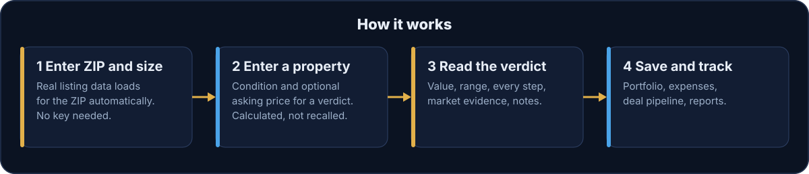
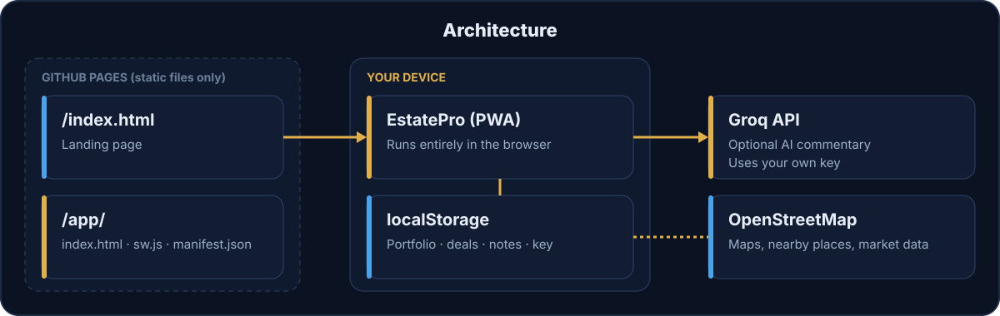

<p align="center"></p>

# EstatePro

A free AI real estate toolkit for investors. Value a property, run the deal math and track your portfolio, all in one app that installs on your phone. Your data stays on your device.

## What it is

- **Value**: enter a ZIP, living area and condition. The value is calculated from real realtor.com listing data for the ZIP (median $/sq ft, size, asking-to-sale gap, condition), with every step shown, a range and a verdict against the asking price. AI only comments on the numbers.
- **Analyze**: mortgage, rental ROI, cash flow and cap rate, plus a side-by-side compare for up to three properties.
- **Track**: portfolio with expenses and reports, and a deal pipeline from watching to closed.
- **Location and market**: map, nearby places and market snapshots.

Valuations are estimates from listing data (asking prices, not closed sales), not appraisals. Verify with closed sales, MLS or your county property appraiser before you act.



## Live URLs

- Landing page: https://johnlaz.github.io/estatepro/
- App: https://johnlaz.github.io/estatepro/app/

## Repo layout

```
/index.html          landing page
/README.md
/docs/               README graphics (SVG)
/app/index.html      the app (single file)
/app/manifest.json   PWA manifest
/app/sw.js           service worker
/app/icon-192.png    app icon
/app/icon-512.png    app icon
/app/shot-*.png      store screenshots (currently simulated, demo data)
```



## AI and model setup

The valuation itself needs no key. EstatePro uses [Groq](https://console.groq.com) with your own free API key only for optional AI commentary (it explains the numbers, it never produces them).

1. Create a key at console.groq.com.
2. Open **Settings** in the app and paste it in. The model list refreshes automatically when you save a new key.
3. Tap **Refresh models** any time to pull Groq's current chat models into the picker.

Your saved model and the three built-in choices are never replaced. If Groq retires a model you picked, the app keeps it and flags it so you can choose another.

## Data and privacy

- Portfolio, deals, notes, history and your API key live in your browser's local storage (key `lazestate_v1`, kept from earlier versions so nothing is lost).
- Market data is fetched as static files from [Zip Market Explorer](https://petelazzaro.github.io/zip-market-explorer/) by the GeniusPete Project (realtor.com Inventory Core Metrics). Whole regional files are downloaded, so the app never sends your property or exact ZIP anywhere. They are cached in your browser for three days. The ZIP cross-check uses Zillow's public Home Value Index (Zillow Research). EstatePro serves its own trimmed data from `app/d/` (last 24 months, about 34 MB) and only falls back to the explorer's site if that fails. A scheduled GitHub Action (`.github/workflows/refresh-data.yml`) rebuilds it each month from realtor.com's free Inventory Core Metrics files using `tools/build.py` (from Zip Market Explorer, GeniusPete Project) and `tools/trim-market-data.py`; run it by hand from the Actions tab any time.
- The only data that leaves your device is the property description you submit for AI commentary (sent to Groq with your key, only if you added one), plus map lookups to OpenStreetMap.
- Use **Settings → Export** to back up or move your data. Clearing site data erases it.

## Deploy and update

Static files only, served by GitHub Pages from the repo root.

1. Commit the files to `main` of the `estatepro` repo.
2. Pages → Deploy from branch → `main` / root.
3. To ship a change, bump `VERSION` in `app/sw.js` **and** `APP_VERSION` in `app/index.html` so the visible version stamp and the cache name match.
4. Installed apps show an **Update ready — Reload** bar the next time they open online.

## Changelog

### 4.3.3
- Map It: removed a geocoder option that caused the lookup to fail in some browsers.

### 4.3.2
- Site Analysis: fixed Map It and Nearby POIs, which crashed on an undeclared variable. Nearby POIs now maps a typed address by itself. Monthly data job: fixed a trim-step bug found on its first run.

### 4.3.1
- Phones: pop-up windows (Settings, Notes and the rest) now stop above the bottom tab bar, and the Save button stays pinned at the bottom of Settings.

### 4.3.0
- Explorer search now shows a dropdown with ZIP, town and type, matching ZIP prefixes first.
- Zillow Home Value Index by ZIP (Zillow Research, public CSV) added as a cross-check on the valuation and a tile in the Explorer. It is a modeled typical-home value, not sold prices. Built monthly by `tools/build_zhvi.py` in the same Action; it appears after the Action's first successful run.

### 4.2.1
- AI models: Groq retired llama-3.3-70b and llama-3.1-8b (Aug 2026). Defaults are now gpt-oss-120b, qwen3.6-27b and gpt-oss-20b; a saved retired model is moved automatically, the list refreshes daily with a key, and a failed call retries once on a current model.
- Site map: switched tiles to OpenStreetMap (the previous CARTO tiles now require a key). Settings: Save button stays visible.

### 4.2.0
- New Explorer tab: browse any ZIP, county, metro, state or the US with trends, market read, state rankings and a one-tap jump into a valuation. Contact link (lazlab.io@gmail.com) added to the Notes panel.

### 4.1.0
- Valuation is now calculated from real ZIP-level market data (realtor.com listing metrics via Zip Market Explorer) instead of an AI recalling comps. Every step is shown, tagged data, assumption, estimate or yours.
- Verdict and deal grade are computed from the asking price against the calculated range. The AI no longer produces any number.
- One AI call per valuation (was five), optional, and it only interprets the numbers. The value works with no Groq key.
- Removed fields that changed nothing: Parse URL (never worked), Floor/Unit, Utilities, Property Segment. Beds, baths, year built, lot and features moved to optional detail. Added ZIP, which fills city and state.
- Market tab shows real data: median list price, inventory, days on market, price cuts, pending ratio, state percentile ranks and a data-driven market read. Removed invented scores (walkability, schools, investment score) and the hard-coded mortgage rate.
- Lookup no longer writes an AI-recalled price into the asking field, and flags AI-recalled living area for verification.
- The adjustment slider now recalculates the verdict and range, no longer carries over between properties and no longer floods history.
- Credit added for the GeniusPete Project (Zip Market Explorer) across the landing page, README, app and results. Removed a stray `'+` that rendered at the bottom of the page.

### 4.0.0
- Fixed a script error that stopped every button in the previous build.
- Renamed to EstatePro with a new icon and navy and gold design.
- Mobile tab bar with Tools and More sheets; valuation form trimmed with optional detail folded away.
- Groq model list refresh on key save and a Refresh button; saved models are never swapped.
- Service worker rewritten: network-first pages, update prompt, versioned cache.
- Flattened repo: removed duplicate icons and unused files; manifest has 192 and 512 icons plus screenshots.
- Version stamp, accessibility labels, larger tap targets, honest estimate notice.

---

A LAZLAB Creations × GeniusPete Project collaboration. Market data and method: [Zip Market Explorer](https://petelazzaro.github.io/zip-market-explorer/) by the GeniusPete Project.

© 2026 LAZLAB Creations. All Rights Reserved. · lazlab.io@gmail.com
